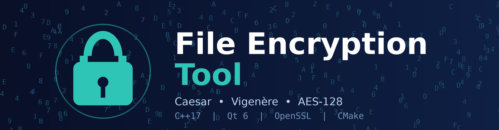

<div align="center">



# 🔐 File Encryption Tool

**A C++ and Qt 6 desktop application for encrypting and decrypting files using Caesar Cipher, Vigenère Cipher and AES-128.**


[🎥 Demo Video](https://youtu.be/h1ehih1wZ0I) · [📄 Report (PDF)](report/report.pdf) · [🐞 Issues](https://github.com/fahim-foysal828/FileEncryptionTool/issues)

</div>

---

## 📑 Table of Contents

- [About](#-about)
- [Demo](#-demo)
- [Features](#-features)
- [Technologies Used](#-technologies-used)
- [Project Structure](#-project-structure)
- [How the Application Works](#-how-the-application-works)
- [Algorithms](#-algorithms)
- [AES Encrypted File Structure](#-aes-encrypted-file-structure)
- [Output File Naming](#-output-file-naming)
- [Build and Run](#-build-and-run)
- [Security Notes](#-security-notes)
- [Future Improvements](#-future-improvements)
- [Contributor](#-contributor)
- [Supervisor](#-supervisor)

---

## 📖 About

File Encryption Tool is a password-protected desktop application. A user selects a file, enters a password, chooses an algorithm and clicks **Encrypt** or **Decrypt**. It supports both text and binary files and demonstrates practical use of classical ciphers alongside a modern AES-128 implementation built on OpenSSL.

This project was developed for the **ICT 1200 – Project** course for educational purposes.

## 🎥 Demo

[](https://youtu.be/h1ehih1wZ0I)

▶️ Full demonstration: <https://youtu.be/h1ehih1wZ0I>

## ✨ Features

- 📂 File selection using a **Browse** button
- 🔑 Password-protected encryption and decryption
- 🔤 Caesar Cipher and Vigenère Cipher
- 🛡️ AES-128-CBC encryption and decryption
- ✅ SHA-256 password verification
- 🧂 Random salt generation for AES-128
- 🔁 PBKDF2-HMAC-SHA256 key derivation (100,000 iterations)
- 🎲 Random IV generation for AES-128
- 👁️ **Show Password** option
- 💬 Encryption and decryption status messages
- 🗑️ Original file removed after successful encryption; encrypted file removed after successful decryption
- 📄 Supports text and binary files (one file at a time)

## 🧰 Technologies Used

| Technology | Purpose |
|---|---|
| **C++17** | Main programming language |
| **Qt 6 (Widgets)** | Desktop GUI framework |
| **CMake** | Build configuration |
| **MinGW 64-bit** | Compiler |
| **OpenSSL** | Cryptographic operations |
| **SHA-256** | Password verification |
| **PBKDF2-HMAC-SHA256** | AES key derivation |

## 🗂️ Project Structure

```
FileEncryptionTool/
├── src/
│   ├── main.cpp          # Application entry point
│   ├── mainwindow.h      # MainWindow class declaration
│   ├── mainwindow.cpp    # GUI logic + encryption/decryption
│   └── mainwindow.ui     # Qt Designer GUI layout
├── report/
│   ├── report.tex        # LaTeX source of the project report
│   └── report.pdf        # Compiled report
├── assets/
│   └── banner.png        # README banner
├── CMakeLists.txt        # Build configuration (Qt + OpenSSL)
├── README.md             # Project documentation
└── .gitignore
```

## ⚙️ How the Application Works

1. Select a file using the **Browse** button.
2. Enter a password.
3. Select an encryption algorithm.
4. Click **Encrypt** or **Decrypt**.
5. The application processes the file and displays the operation status.

## 🔬 Algorithms

### 1. Caesar Cipher

Processes file data byte by byte. The shift is derived from the password.

```
Shift     = (sum of password character Unicode values) % 256
Encrypt   : Encrypted = (Original + Shift) % 256
Decrypt   : Original  = (Encrypted - Shift + 256) % 256
```

### 2. Vigenère Cipher

Uses the password as a repeating key.

```
Shift     = Password character Unicode value % 256
Encrypt   : Encrypted = (Original + Shift) % 256
Decrypt   : Original  = (Encrypted - Shift + 256) % 256
```

### 3. AES-128 (OpenSSL)

```
Password → Random Salt → PBKDF2-HMAC-SHA256 (100,000 iterations)
         → 16-byte AES key → AES-128-CBC (random 16-byte IV) → Ciphertext
```

### Password Verification

```
Entered Password → SHA-256 → 32-byte hash → compare with stored hash
```

If the hashes do not match, the application shows **"The password is incorrect."** The password itself is never stored.

## 📦 AES Encrypted File Structure

| Size | Content |
|---|---|
| 32 bytes | SHA-256 password hash |
| 16 bytes | Salt |
| 16 bytes | IV |
| Remaining | Ciphertext |

## 📝 Output File Naming

| Operation | Input | Output |
|---|---|---|
| Encrypt | `original.txt` | `original_encrypted.txt` |
| Decrypt (Caesar / Vigenère) | `original_encrypted.txt` | `original_decrypted.txt` |
| Decrypt (AES-128) | `original_encrypted.txt` | `original.txt` |

For Caesar and Vigenère the file is processed in 4096-byte chunks. For AES-128 the file is read into memory before processing.

## 🚀 Build and Run

**Requirements:** Qt 6, a C++17 compiler (MinGW 64-bit), CMake 3.16+, OpenSSL.

```bash
git clone https://github.com/fahim-foysal828/FileEncryptionTool.git
cd FileEncryptionTool
```

**Using Qt Creator (recommended)**

1. Open `CMakeLists.txt` in Qt Creator.
2. Select the *Desktop Qt 6 MinGW 64-bit* kit and click **Configure Project**.
3. Make sure OpenSSL is detected. `CMakeLists.txt` currently sets `OPENSSL_ROOT_DIR` to `C:/msys64/ucrt64`; change it if OpenSSL is installed elsewhere.
4. Build (`Ctrl+B`) and run (`Ctrl+R`).

## 🔒 Security Notes

- Caesar and Vigenère are classical educational ciphers and are **not** secure for real-world use.
- AES-128 is implemented with OpenSSL in CBC mode, with a random salt and IV and PBKDF2 key derivation.
- The current implementation does **not** use an HMAC or authentication tag, so it does not provide authenticated encryption or dedicated tamper detection.

## 🔮 Future Improvements

- [ ] Add HMAC or authenticated encryption (e.g., AES-GCM)
- [ ] Improve the password verification design
- [ ] Add AES streaming for very large files
- [ ] Add more encryption algorithms
- [ ] Cross-platform packaging
- [ ] Better error logging and file integrity protection

## 👤 Contributor

| Name | Student ID |
|---|---|
| Md. Fahim Foysal | IT-25055 |

## 🎓 Supervisor

**Dr. Ziaur Rahman**
Professor, Department of ICT
Mawlana Bhashani Science and Technology University

---

<div align="center">

Developed for **ICT 1200 – Project** · For educational purposes only

</div>
